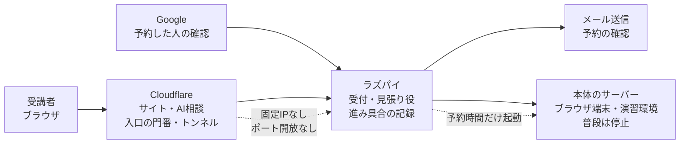
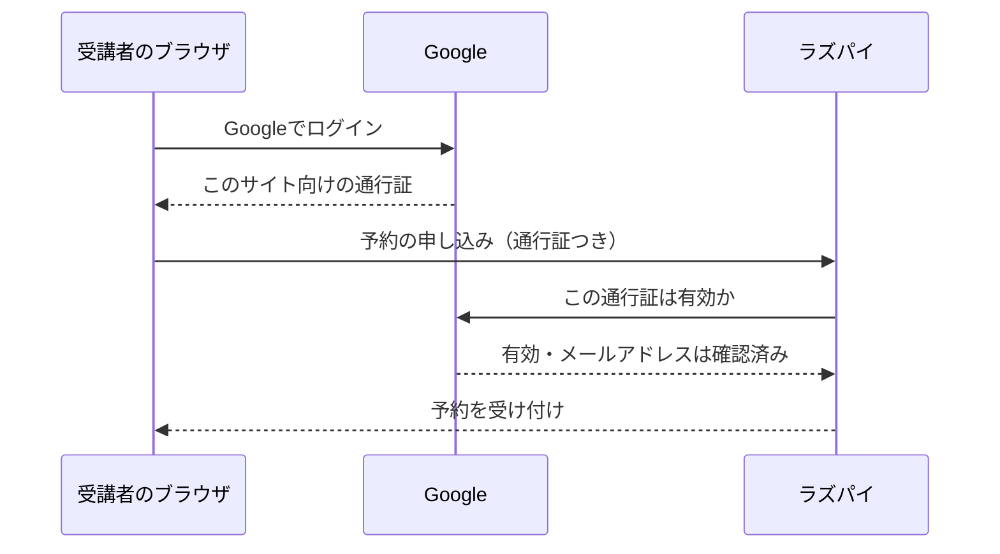
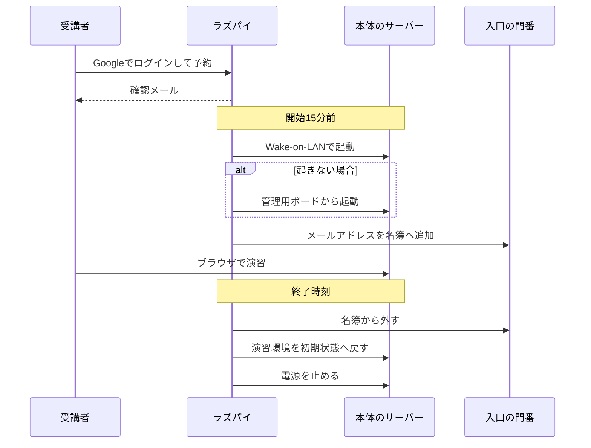

自宅のサーバー1台で、Linuxの学習サイトを公開しようとしています。個人でやっているので、予算はそれほどありません。最初に引っかかったのはお金でした。

初めに考えたのは固定IPです。ところが調べてみると、固定IPの契約は意外とお金がかかることが分かりました。ケチなだけかもしれませんが。

もう一つは電気代です。予約は24時間いつでも受け付けられないと意味がありません。かといって本体のサーバーを24時間動かし続けると、電気代がかさみます。個人の予算では、ここがしんどいところでした。

*「お金をかけずに、外から自宅のサーバーを起こして止められないか」*

手持ちの機材は、サーバー1台とラズベリーパイ（以下ラズパイ）1台です。調べてみると、ラズパイは24時間動かし続けても電気代が小さく済むようでした。そこで、24時間起きている役はラズパイに任せ、必要なときだけサーバーを起こすきっかけにできないかと考えました。

残ったのは、外から自宅へどう入ってもらうかです。ここでCloudflareの仕組みを使うことにしました。CloudflareはWebサイトの配信や、インターネットと自宅のあいだの中継を引き受けてくれるサービスです。自宅側から外へ向けてトンネルをつなぐ仕組みがあるので、固定IPもルーターのポート開放も要りません。入口で利用者を確かめる機能も、登録する利用者が50人までなら無料の枠で使えます。

いまは本体のサーバー1台とラズパイ1台、それにCloudflareと、予約画面のログインに使うGoogleのサービスで動いています。[6月に書いた全体構成](https://zenn.dev/infra_study_ze/articles/homelab-architecture-overview)の、その後の姿です。

固定IPの料金も、本体を24時間動かす電気代も払わないと決めると、外との窓口はCloudflare、24時間の受付は小さなラズパイ、本体は予約の時間だけ外から起こして止める、という分担に自然と決まりました。

## この記事で分かること

- 固定IPを契約せず、自宅へ入る窓口を外側に置いた理由
- 24時間動かす役と、予約中だけ動かす役を分けた考え方
- Googleのログインで「予約した人が誰か」を確かめる仕組み
- 予約から起動、演習、復元、停止までをつないだ全体の流れ

## 24時間動かすものを小さくした

最初に決めたのは、本体のサーバーを受付にしないことでした。本体が予約を受け付けるなら、予約がない夜中も電源を入れておく必要があります。
そこで、受付と見張りはRaspberry Pi 3B+へ移しました。2018年の機種ですが、予約を見て本体を起こす役なら、この小さな機械で足ります。

一方、本体のサーバーにはProxmox VEが入り、ブラウザで使える端末、中継のサーバー、演習用のサーバーなどの仮想マシンが載っています。電気を使う本体は、普段は止めています。

図にすると、自宅で24時間動かしている機械はラズパイだけです。Cloudflareは外から来た通信の窓口になり、ラズパイは予約を見ながら本体の電源を管理します。

### Cloudflareは外との窓口

Cloudflareには、静的な学習サイトの配信、自宅へつなぐトンネル、入口の門番、AI相談の機能を任せています。

門番を通れるのは、入ってよい人の名簿に載っている人だけです。使い始めてみると、サイトの配信と自宅への入口を同じ側でまとめて扱えるようになりました。

### ラズパイは24時間の受付

ラズパイで常に動いている役は、予約の受付、予約の見張り、学習の進み具合の記録、Cloudflareへのトンネルの4つです。

見張り役は約33秒ごとに予約を確かめます。開始前なら本体を起こし、終了後なら入口を閉じて演習環境を戻し、本体を止めます。

予約と進み具合の記録は、毎晩3時半にバックアップしています。控えは30世代を残しています。

### 本体は演習の時間だけ動く

本体のサーバーは、受講者が触る仮想マシンを動かす場所です。ブラウザ端末から中継のサーバーを通り、Linuxやネットワークの演習環境へ入ります。

ここを24時間動かさず、予約の前に起こす形にしました。予約がないのに起きていれば、ラズパイの見張り役が止めます。

### Googleで「予約した人」を確かめる

予約画面のログインにGoogleを使っているのは、予約した人が誰なのかを確かめるためです。自分でパスワードを預かる仕組みを作らずに済み、受講者も新しいアカウントを作らずに済みます。

受講者が「Googleでログイン」を押すと、Googleが本人を確かめて、ブラウザに「このサイト向けの通行証」を渡します。予約を申し込むとき、ブラウザはその通行証を一緒にラズパイへ送ります。ラズパイは受け取った通行証をGoogleに問い合わせ、Googleが有効と認める通行証か、このサイト向けに出されたものか、メールアドレスが確認済みかの3つを確かめます。3つとも通ったときだけ、そのメールアドレスを「予約した人」として扱います。Googleへの問い合わせ自体が失敗したときも、予約は受け付けません。

ここで確かめたメールアドレスが、このあとの仕組み全体の鍵になります。確認メールの宛先も、入口の名簿に足す名前も、同じアドレスです。

*「ブラウザが名乗った名前を、そのまま信じてはいけない」*

最初は、Googleカレンダーを予約の台帳にする形も考えました。カレンダーに予定が入ったら、ラズパイがそれを読み取って本体を起こす形です。予約画面を作らずに済むので、手間はいちばん少なく見えました。ところが、「1人あたり週2枠まで」「1日3枠まで」といった上限の決まりは、カレンダーの標準の予約の仕組みだけでは表せません。キャンセルや重なった予約の扱いも、結局は自分で作ることになります。そこで予約画面と台帳は自分で作り、Googleはログインだけに使うことにしました。

## 予約すると、本体が起きる

予約は1枠2時間で、開始時刻は10時、13時、16時、19時の4つです。1日に使えるのは3枠までで、予約は開始10分前まで受け付けています。

受講者はGoogleでログインして枠を選びます。上で確かめたメールアドレスが、ここから先の名簿とメールに使われます。

開始15分前になると、見張り役がWake-on-LANを送ります。ネットワーク越しに電源を入れてから、本体が応答するまでは実測で約85秒でした。

本体が起きたら、見張り役は予約した人のメールアドレスを入口の名簿へ足し、演習用のパスワードを用意します。受講者は専用ソフトを入れず、ブラウザだけで端末を開けます。

終了時刻になると、順番を逆にたどります。名簿からメールアドレスを外し、演習環境を初期状態の控えへ戻してから、本体の電源を止めます。

この仕組みで動いている演習環境は、Part 1とPart 2なら[無料で予約して触れます](https://infra-study.org/)。

## 手作業の名簿では続かなかった

6月に全体構成を書いた時点では、入口の名簿を予約のたびに手で直すつもりでした。人数が少なければ、それでも回せると思っていたからです。でも、申し込みのたびに人の作業が入る形は続きません。予約を受けたのに名簿へ足し忘れれば、開始時刻になっても受講者は入口を通れず、本体を起こした電気代も無駄になります。

*「予約が入るたびに、自分が入口を開けるのは無理だ」*

そこで2026年10月から、予約に合わせて見張り役が名簿へ出し入れする形で動かしています。受付だけ自動でも足りず、入口を開けて閉じるところまでつながって、ようやく人が待機しなくてよくなりました。

## Wake-on-LANだけでは起きない日があった

本体の電源は、最初にWake-on-LANで入れます。ところが、4通りの送り方をすべて試しても、本体が起きない日がありました。予約があるのに本体が起きなければ、受付や名簿の仕組みがすべて正しく動いていても演習は始まりません。そこで、起きなかったときは本体の管理用ボードから電源を入れる二段構えにしました。

Wake-on-LANそのものは、以前書いた[自宅サーバーを遠隔で起こす話](https://zenn.dev/infra_study_ze/articles/homelab-wake-on-lan)で扱っています。この記事では、予約の流れに組み込んだ電源投入の一手段としてだけ置いています。

ただ、ラズパイが止まると予約を見られず、本体も起こせません。24時間動かす部分を小さな機械へまとめた分、そこが急所になっているのは、この構成の正直な弱点です。

## この記事で扱わないこと

この記事は、予約から本体の停止までをつないだ全体地図です。次の内容は、部品ごとの続編に分けます。

- 予約してからブラウザ端末が開くまでの細かな動き
- ラズパイで4つの役を常に動かす方法
- 予約した人だけを入口へ通す方法（名簿を予約に合わせて自動で出し入れする仕組み）
- 本体を起こし、起きなければ別の方法へ切り替える手順
- 演習環境を終了後に初期状態へ戻す方法
- 各サービスの設定手順、認証の内部、ネットワークの細部

一度に全部を書くと、全体の分担より設定値の話が大きくなります。まずは、どの部品が何のために置かれ、予約1回でどう動くのかだけを残しました。

## まとめ

固定IPの契約を足さず、本体を24時間動かさないと決めたことで、外との窓口はCloudflare、常時の受付はラズパイ、演習は予約中だけ起きる本体、という形になりました。

この仕組みで動く[infra-study.org](https://infra-study.org/)は、Part 1なら登録なしで読めます。実機の演習はGoogleログインで予約できます。

---

## ご紹介

自分は、自宅に物理サーバーを置いて、インフラを学べる場所を作っています。

教材は登録なしで無料で読めます。実機のサーバーに接続する演習は構築中で、まだ全章には対応していません。

**全章インデックス:** [infra-study.org/curriculum](https://infra-study.org/curriculum)

**感想フォーム:** [感想フォーム（Tally）](https://tally.so/r/eqvX8l)

---

X（@taro3_01）で更新を告知しています。フォローすると次回の通知が届きます。

@[card](https://x.com/taro3_01)
