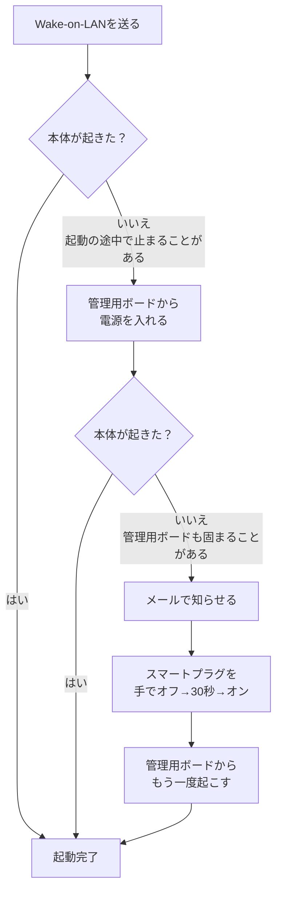

ある朝、自宅のサーバーを起こそうとしたら、Wake-on-LANを何度送っても起きませんでした。

送り方を4通り変えても無反応でした。設定が消えたのだと思い込んで調べ始めましたが、原因はネットワークではありませんでした。

*「家にいないときにこれが起きたら、予約した人に何と言えばいいのか」*

自宅のサーバーで、予約した時間だけ使えるLinuxの演習環境を作っています。本体のサーバー1台を普段は止めておき、予約の時間だけラズパイから起こす構成です（全体の仕組みは前回の記事に書きました）。ところが本体は、前夜に意図せず始まった起動の途中で止まっていました。

いちばん不安だったのは、ハードウェアが壊れたのではないか、ということです。結局、メモリで何が起きたのかは分からないままでした。

直せないなら、次に同じことが起きたときの逃げ道を作るしかありません。Wake-on-LAN、管理用ボード（サーバーに付いている遠隔管理の部品）、スマートプラグの3段を用意した、という話です。

## この記事で分かること

- Wake-on-LANで起きないとき、最初に本体の起動状態を見る理由
- 設定、ネットワークの順で確認し、思い込みを外した切り分け
- 管理用ボードも固まる日に備え、起こす経路を3段にした考え方

## 1. Wake-on-LANの設定を疑った

2026年7月30日の朝、まず疑ったのはWake-on-LANの送り方でした。

LAN全体への一斉送信、同じ区画（サブネット）への一斉送信、宛先を指定した送信、パケットを自分で組み立てる送信。4通り試しても、本体から応答はありません。以前の記事でも、OS側の設定を確認し、起動のたびに有効に戻す仕組みを作っていたので、設定が消えたという疑いは自然に見えました。

*「Wake-on-LANの待機設定が消えたのでは？」*

でも、この時点では順番を間違えていました。

電源が切れているように見えても、本当に待機状態とは限りません。起動の途中で止まっていれば、新しい起動要求を送っても先へ進まないからです。この違いを確かめず、送信側だけを変え続けていました。

## 2. 本体はすでに起動の途中で止まっていた

家で本体の前に立つと、ファンが全開で鳴っていました。管理用ボードにもつながらず、電源ケーブルを抜いて戻してから、ようやく記録を読めました。そこに、メモリの初期化に失敗した記録が残っていました。

管理用ボードは、OSとは別に動く遠隔管理の部品です。本体のOSが起動する前の記録も読めます。そこにあったのは、起動の途中の自己診断でメモリを初期化できなかった、という内容でした。

Wake-on-LANが本体を起こせなかったのではありません。本体はすでに起動を始め、その途中で固まっていました。電源オフの本体へ送るはずの要求を、起動途中で止まった本体へ何度も送っていました。

:::details 7月30日に確認した記録（公開用に一部を日本語化）
```text
2026-07-29 23:18:22 重大: メモリの初期化に失敗
           メモリの初期化中に致命的なエラーを検出
```
:::

この状態では、ネットワーク越しの電源投入を何度送り直しても変わりません。送り方を4通り試したこと自体が、原因へ近づく検査になっていませんでした。

その後、同じメモリ初期化の失敗は5回記録されました。日付は7月30日、8月16日、8月18日、10月14日、10月19日です。ただし、5回すべてがWake-on-LANから始まったとは確認できません。8月16日と18日には、直前の起動要求の記録がないためです。

回数だけをつないで「Wake-on-LANが5回失敗した」とは書けません。分かったことと、分からないことを分ける必要がありました。

## 3. 10月の記録で「届いていた」と分かった

10月14日と19日は、もう少しはっきりした記録が残りました。

Wake-on-LANの要求を受け付け、電源が戻ったあと、どちらも約34秒でメモリの初期化に失敗しています。要求の受付、電源の復帰、メモリ初期化の失敗という順番が、時刻つきで残っていました。

:::details 10月14日と19日の起動記録（公開用に一部を日本語化）
```text
2026-10-14 15:45:11  Wake-on-LANの要求を受け付け
2026-10-14 15:45:14  本体の電源が復帰
2026-10-14 15:45:48  メモリの初期化に失敗

2026-10-19 13:00:14  Wake-on-LANの要求を受け付け
2026-10-19 13:00:17  本体の電源が復帰
2026-10-19 13:00:51  メモリの初期化に失敗
```
:::

10月19日は、前日の正常停止も確認できました。それでも翌日の起動中に止まりました。

ここで初めて、「Wake-on-LANが届かなかった」と「届いたあとに起動できなかった」を分けて考えられました。

Wake-on-LANは、電源を入れるきっかけを渡すところまでです。メモリの初期化やOSの起動を最後まで保証する仕組みではありません。パケットが届いたかだけでなく、電源投入後にどこまで進んだかを見る必要がありました。

## 4. 設定とネットワークは後から外した

本体を復帰させたあと、Wake-on-LANの待機設定を確認しました。

```bash
ethtool <インターフェース名> | grep Wake-on
```

結果は有効なままでした。

```text
Supports Wake-on: g
Wake-on: g
```

「設定が消えた」という最初の推測は外れです。設定を直していないのに値が残っていたので、この日の原因にはできません。

ネットワークも同じです。10月の記録では、Wake-on-LANの要求を管理用ボードが受け付けています。少なくともその2回はパケットが本体まで届き、ネットワークの入口より先で止まっていたことになります。

今回の順番を振り返ると、次のようになりました。

1. 本体が起動の途中で止まっていないか、管理用ボードの記録を見る
2. 本体を復帰できたら、Wake-on-LANの待機設定を確認する
3. 起動要求の記録もないときに、送信元やLANの経路を調べる

最初からこの順番を知っていたわけではありません。送り方を変え続けたあとで、ようやく順番が逆だったと気づきました。

## 5. 起こす経路を3段にした

原因を見つけても、家の外から本体を復帰できなければ運用では困ります。

そこで、起こす手段を3段にしました。



1段目はWake-on-LANです。普段はこれだけで起動します。

2段目は管理用ボードです。Wake-on-LANで応答がなければ、管理用ボードへ電源投入を頼みます。

ただ、Wake-on-LANで起き続けるあいだは、この経路は一度も動きません。そこで8月4日に、わざと届かない宛先へWake-on-LANを送って試しました。20秒応答がないのを確かめて管理用ボードから電源を入れると、85秒で本体が応答しました。普段使わない予備の経路も、一度通しておいたことで使えると確認できました。

ただ、10月19日は管理用ボードまで固まりました。pingには応答し、接続口も開いているのに、状態の問い合わせは90秒待っても0バイトでした。

*「予備の経路が見えているのに、操作には答えない」*

これでは2段目からも起こせません。そこで3段目として、スマートプラグを置きました。

## 6. スマートプラグは本体を直接起こさない

ここは少し分かりにくいところです。

スマートプラグで電源を入れ直せば、本体がそのまま起動するわけではありません。本体は、電源が戻っても自分では起動しない設定にしています。

3段目の目的は、固まった管理用ボードを生き返らせることです。

2026年10月25日に、スマートプラグをオフにして30秒待ち、オンへ戻しました。固まっていた管理用ボードが復帰し、そこから本体へ電源投入を頼むと、90秒で応答しました。

本体の「電源が戻っても起動しない」という設定は、管理用ボードから読み取って確かめてあります。だからプラグを入れ直したあとは、必ず管理用ボードから起こします。3段目は新しい起動方法ではなく、2段目をもう一度使える状態へ戻す逃げ道です。

:::message alert
稼働中の本体へ電源の入れ直しをすると、データを壊すおそれがあります。この記事の構成でも、スマートプラグの操作は自動化せず、起動失敗の通知を見たあとに人が判断します。
:::

自動化も考えました。でも、管理用ボードが固まっているときに、本体が停止中だと別の経路から確実に示す方法を作れませんでした。

誤って稼働中の電源を切るくらいなら、自動化しないほうが安全です。起動に失敗したらメールで知らせ、スマートプラグはアプリから手で操作する形にしました。

## 7. 直したのではなく、逃げ道を作った

メモリ初期化の失敗が、なぜ繰り返したのかは分かっていません。

復帰後には、本体の内蔵時計が1970年1月1日に戻った記録もありました。内蔵時計の電池やメモリ周りを疑っていますが、部品交換による根本対策はまだです。

ハードウェアが壊れたのではないか、という不安は残っています。それでも、起きなかったときに家へ戻るしかない状態から、外から復旧を試せる状態には変えられました。

今回作ったのは、次の3段です。

- 普段はWake-on-LANで起こす
- 起きなければ管理用ボードから起こす
- 管理用ボードも固まったら、通知を受けて手で電源を入れ直す

## この記事で扱わないこと

この記事では、本体の設定画面、管理用ボード、スマートプラグの設定手順は扱いません。内部のネットワーク構成、認証情報、通知先も載せません。

メモリ初期化の失敗に対する修理手順も扱いません。原因を部品単位で特定できておらず、直ったと確認できる作業をまだしていないためです。

## まとめ

Wake-on-LANで起きないときは、まず本体が起動の途中で止まっていないかを見る。根本原因を直せない間も、起こす経路を重ねれば、家の外から復旧を試せるところまでは作れます。

---

## ご紹介

自分は、自宅に物理サーバーを置いて、インフラを学べる場所を作っています。

教材は登録なしで無料で読めます。実機のサーバーに接続する演習は構築中で、まだ全章には対応していません。

**全章インデックス:** [infra-study.org/curriculum](https://infra-study.org/curriculum)

**感想フォーム:** [感想フォーム（Tally）](https://tally.so/r/eqvX8l)

---

X（@taro3_01）で更新を告知しています。フォローすると次回の通知が届きます。

@[card](https://x.com/taro3_01)
