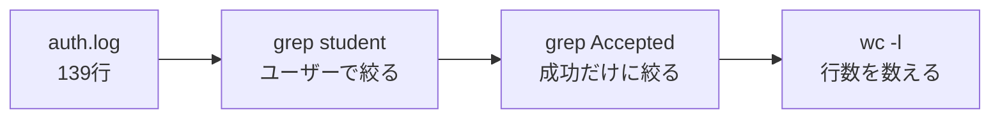

「ログインできない」と言われたとき、原因を探す場所が分からないと、ログを上から全部読むことになります。反対に、誰かに入られていないか不安でも、どの行を見ればよいのか最初は迷います。仕事では`w`・`last`・`lastb`を打ち、`/var/log/messages`を眺めて特定していましたが、改めてUbuntuの`auth.log`を読んでみました。ログインの失敗を調べるのに、ログを全部読む必要はなく、`grep`で2段に絞るだけで「誰が・いつ・どこから・成功か失敗か」が読めます。

この記事で分かることは、次の3つです。

- UbuntuでSSHログインの成功と失敗が残る場所を探せます
- 認証ログの1行から、日時や接続元を読み取れます
- `grep`とパイプを使い、必要な行だけ2段で絞れます

## 139行でも、上から読むのはつらい

使ったのは、Ubuntu 24.04の演習用サーバです。2026年10月26日、別のサーバから学習用アカウントへSSHで接続し、わざとパスワードを3回間違えました。そのあと、正しいパスワードでも何回かログインしています。

最初に、認証ログが何行あるのか数えました。

```bash
wc -l /var/log/auth.log
```

```text
139 /var/log/auth.log
```

まだ使い始めたばかりのサーバでも139行あります。本番で動き続けているサーバなら量は桁違いになるので、先頭から目で追う方法では、調べたい行へたどり着く前に見落としそうです。

*「この中から、失敗した3回だけをどう拾おう」*

そこで、まずはログを1行だけ取り出し、何が書かれているのかを分けてみます。

## 成功した1行を左から読む

SSHログインに成功した行は、次の形で残っていました。

```text
2026-10-26T10:31:16.533581+09:00 <ホスト名> sshd[1605]: Accepted password for student from <接続元IP> port 58196 ssh2
```

左から順に見ると、1行の中身は次のように分かれます。

| 部分 | 読めること |
|---|---|
| `2026-10-26T10:31:16.533581+09:00` | ログが記録された日時 |
| `<ホスト名>` | ログを出したサーバのホスト名 |
| `sshd[1605]` | ログを出したプロセス名と番号 |
| `Accepted password` | パスワード認証に成功したこと |
| `for student` | ログインしたユーザー名 |
| `from <接続元IP>` | 接続元のIPアドレス |
| `port 58196` | 接続元で使われたポート番号 |

長く見えますが、探す場所は決まっています。成功なら`Accepted password`、失敗なら`Failed password`です。その前後を見れば、ユーザー名と接続元も同じ行で分かります。

:::message
ここに出る`port`は、接続先サーバのSSH待受ポートではありません。この接続で、接続元が使ったポート番号です。
:::

## まずユーザー名で絞る

学習用アカウントに関係する行だけを、`grep`で抜き出しました。

```bash
grep "student" /var/log/auth.log
```

出力は長いので、一部の行だけを載せます。

```text
2026-10-26T10:31:16.533581+09:00 <ホスト名> sshd[1605]: Accepted password for student from <接続元IP> port 58196 ssh2
2026-10-26T10:31:16.536728+09:00 <ホスト名> sshd[1605]: pam_unix(sshd:session): session opened for user student(uid=1003) by student(uid=0)
2026-10-26T10:31:16.560577+09:00 <ホスト名> systemd-logind[840]: New session 9 of user student.
2026-10-26T11:31:54.901226+09:00 <ホスト名> sshd[1808]: pam_unix(sshd:auth): authentication failure; logname= uid=0 euid=0 tty=ssh ruser= rhost=<接続元IP>  user=student
2026-10-26T11:31:57.248656+09:00 <ホスト名> sshd[1808]: Failed password for student from <接続元IP> port 48920 ssh2
2026-10-26T11:31:59.507598+09:00 <ホスト名> sshd[1808]: Connection closed by authenticating user student <接続元IP> port 48920 [preauth]
```

ユーザー名で絞っても、成功、失敗、セッション開始、切断が一緒に出ます。ただ、139行を全部読むより、調べたい人に関係する行だけを見るほうが、かなり追いやすくなりました。

:::message
ここからの手順は、[本物のサーバで無料で試せます](https://infra-study.org/part1-chapter04)。実機の操作を再生できる画面があるので、先に動きを見てから同じコマンドを打てます。
:::

## パイプでもう一度絞る

成功したログインだけを見たいので、先ほどの結果をもう一度`grep`へ渡します。2つのコマンドをつないでいる`|`が、パイプです。

```bash
grep "student" /var/log/auth.log | grep "Accepted"
```

ここでも、一部の行だけを載せます。

```text
2026-10-26T10:31:16.533581+09:00 <ホスト名> sshd[1605]: Accepted password for student from <接続元IP> port 58196 ssh2
2026-10-26T11:32:17.653402+09:00 <ホスト名> sshd[1963]: Accepted password for student from <接続元IP> port 35554 ssh2
2026-10-26T11:32:18.675193+09:00 <ホスト名> sshd[2037]: Accepted password for student from <接続元IP> port 35558 ssh2
```

左側の`grep`が「studentを含む行」を取り出し、その結果だけを右側の`grep`が受け取ります。右側では`Accepted`を探すので、studentの行の中から成功したログインだけが残る、という流れです。



最後に`wc -l`を足すと、表示された行数を数えられます。

```bash
grep "student" /var/log/auth.log | grep "Accepted" | wc -l
```

```text
10
```

このログでは、条件に合う成功の行が10行ありました。`grep`を重ねるたびに、元のログから調べたい範囲が一段ずつ狭くなるのが分かります。

## 3回間違えた跡を捕まえる

今度は、ユーザー名ではなく失敗を表す文字で絞りました。

```bash
grep "Failed password" /var/log/auth.log
```

```text
2026-10-26T11:31:57.248656+09:00 <ホスト名> sshd[1808]: Failed password for student from <接続元IP> port 48920 ssh2
2026-10-26T11:32:02.051443+09:00 <ホスト名> sshd[1810]: Failed password for student from <接続元IP> port 57544 ssh2
2026-10-26T11:32:06.187543+09:00 <ホスト名> sshd[1812]: Failed password for student from <接続元IP> port 57558 ssh2
```

わざと間違えた3回が、そのまま3行で出ました。時刻は11時31分57秒、11時32分02秒、11時32分06秒で、4〜5秒おきです。どの行にも、ユーザー名と同じ接続元が残っています。

*「間違えた回数まで、そのまま見えるのか」*

ただし、失敗が3行あるだけで不正な接続だとは決められません。自分でパスワードを間違えた場合も同じ形で残るため、時刻、ユーザー名、接続元を合わせて、自分たちの操作だったかを確かめます。

:::message alert
見覚えのない接続元や、短時間に続く大量の失敗を見つけた場合は、ログを消したり接続元を決めつけたりせず、管理者へ記録ごと共有します。
:::

## 最新の10行だけを見る

直前に起きたことを見たいなら、`tail`で末尾だけを出せます。ここでは最新の10行を指定しました。

```bash
tail -n 10 /var/log/auth.log
```

10行のうち、3行だけを載せます。

```text
2026-10-26T11:34:04.771151+09:00 <ホスト名> systemd-logind[840]: New session 28 of user student.
2026-10-26T11:34:05.142329+09:00 <ホスト名> sshd[2518]: Disconnected from user student <接続元IP> port 43314
2026-10-26T11:35:00.150685+09:00 <ホスト名> sshd[2571]: Accepted password for student from <接続元IP> port 34348 ssh2
```

`tail`は、起きたばかりの接続や切断をざっと見るときに向いています。誰か一人や、成功・失敗のどちらかへ絞りたいときは、`grep`と組み合わせるほうが目的の行を追いやすくなります。

## `w`、`last`、`lastb`とは役目が違う

仕事では`w`、`last`、`lastb`を打ち、`/var/log/messages`も見ていました。これは間違いという話ではなく、使っているLinuxと、知りたいことによって入口が変わります。

| 見たいこと | コマンド・ログ | 読めるもの |
|---|---|---|
| 今ログインしている人 | `w` | 現在のログイン状況 |
| 過去にログインした人 | `last` | `wtmp`に残ったログイン履歴 |
| 失敗したログイン履歴 | `lastb` | `btmp`に残った失敗履歴 |
| Ubuntuの認証の詳しい行 | `/var/log/auth.log` | SSHやsudoなどの認証ログ |
| RHEL系の認証の詳しい行 | `/var/log/secure` | SSHなどの認証ログ |

`lastb`は失敗履歴をすぐ一覧にできますが、通常はroot権限が必要です。一方、Ubuntuの`auth.log`は、`adm`グループに入っているアカウントなら読めます。今回の学習用アカウントも、その権限で読みました。

仕事で見ていた`/var/log/messages`は、認証専用ではなくシステム全体のログです。RHEL系なら認証のログは`/var/log/secure`に、Ubuntuなら`/var/log/auth.log`に分かれているので、SSHログインを詳しく追うなら、認証専用のほうから探し始めると対象を絞りやすくなります。

## この記事で扱わないこと

ここで扱ったのは、Ubuntu 24.04で、保存済みのSSH認証ログを`grep`と`tail`で読むところまでです。ログの保存期間、ローテーション、リアルタイム監視、接続元の遮断、公開鍵認証の詳しい調査は、同じ一手では決められないため含めていません。

また、ログの1行だけで攻撃者や原因を断定することも扱いません。まず事実を絞って読み、時刻や接続元をほかの記録と照らすための入口にしています。

## まとめ：全部ではなく、条件を重ねて読む

ログインの失敗を調べるときは、`auth.log`を上から全部読むのではなく、ユーザー名と成功・失敗の文字を`grep`で段階的に絞ると、「誰が・いつ・どこから・どうなったか」を1行ずつ追えます。

[Part 1 第4章](https://infra-study.org/part1-chapter04)は登録なしで読めます。実機の演習はGoogleログインで予約し、記事と同じ流れをサーバで試せます。

---

## ご紹介

自分は、自宅に物理サーバーを置いて、インフラを学べる場所を作っています。

教材は登録なしで無料で読めます。実機のサーバーに接続する演習は構築中で、まだ全章には対応していません。

**全章インデックス:** [infra-study.org/curriculum](https://infra-study.org/curriculum)

**感想フォーム:** [感想フォーム（Tally）](https://tally.so/r/eqvX8l)

---

X（@taro3_01）で更新を告知しています。フォローすると次回の通知が届きます。

@[card](https://x.com/taro3_01)
